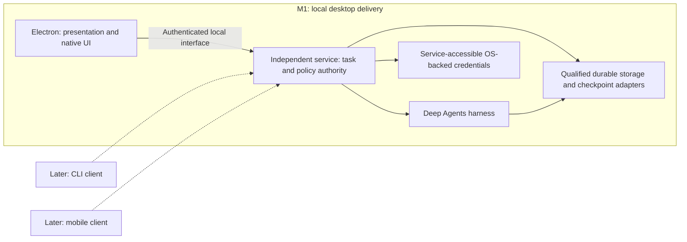

# Milestone one implementation plan

Owner sequencing and publication checkpoint: after the bounded M1-01 synthetic service/storage checks, prioritise configured OpenRouter connection and live testability as prerequisites permit. Before each commit or push, discuss what was tested, outcomes, untested behaviour and confidence, and obtain the owner's go-ahead. This temporary checkpoint remains until the owner retires it; static checks and critique do not waive it.

Status snapshot (27 October 2026): M1-01 and M1-02 are accepted and closed in GitHub Issues. M1-02 implementation and closeout documentation integrated through PRs #11 and #12; `a2615e0f796548831dd0b51c4546f4a99d75a46b` is the M1-03 staging baseline. M1-03 is in progress on `jwill9999/m1-03-allowances`; connected implementation and DT-03 design review are complete in the working tree, practical checks and regression coverage now pass, while hosted PR verification and integration remain outstanding. GitHub Issues owns live status. No whole-milestone, installer or sandbox-product acceptance is implied.
Recorded: 26 October 2026. Scaffold checkpoint: `jwill9999/project-setup`, HEAD `ef40e0f1ceab75b355949db5d736068b1b1e4683`, tree `caaa301874c2c3df2382b700fe1b3e03235723d5`. This is the historical scaffold identity; M1-01 implementation and evidence are identified in the qualification record. This documentation is maintained with the repository.

## Objective and stopping point

Prove OpenRouter setup and persistent General Chat through the real Apple Silicon macOS application, preceded by qualification of the app-managed local runtime. Deliver a reviewable pilot installer and connected acceptance evidence, not a general public launch.

The authoritative product scope is the [product specification](../product-specification.md); source IDs below refer to the [reuse map](source-and-reuse-map.md). GitHub Issues is the development task source of truth, without a Project board or Beads. M1 identifiers are stable planning aliases; the issue mapping below identifies the actual records. Repository documents own specifications; GitHub owns status, claims, dependencies and acceptance evidence. The application runtime queue is separate.

Finish when the pilot installation/setup, real streaming response, Stop, conversation persistence, background continuation, reconnect and explicit Resume journeys meet the acceptance criteria below. Broader document/coding features remain requirements for subsequent milestones.

## Testing order

Follow the owner-agreed [practical-first testing policy](../testing-strategy.md). For each implemented slice, the agent must exercise the actual application with the configured OpenRouter agent and verify independent effects before writing its unit tests. Fix practical failures first. Live practical scenarios are the acceptance authority: automated E2E/unit/CI passes cannot establish a working component or override a failed practical run. Later focused unit/regression tests cover our integration and logic, not framework internals; avoid an extensive mandatory automation programme. Fixtures support diagnosis and subsequent regression coverage; they do not substitute for the practical gate. Builds/typechecks and necessary runtime probes remain available throughout.

## Milestone boundary

Included:

- Local profile; app/service authentication boundary without a hosted account.
- React/TypeScript/Vite/shadcn conversation shell following the inspected Figma references, with required setup/recovery states designed before implementation.
- OpenRouter key validation/storage, model metadata, separate General Chat/Coding defaults; only General Chat executes in M1. Coding selection must clearly disclose its unavailable workflow rather than simulate success.
- One Deep Agents loop, durable conversation/run state, streaming and explicit run identities.
- Independent local-service lifetime, controlled shutdown, disconnect/reconnect, Stop and explicit Resume after interruption.
- Minimal two-active-task queue enforcement for independent General Chat tasks; disable Deep Agents default delegation in M1. Qualify the actual TypeScript profile API and resolved tool inventory. Expose no shell, search/network or document-processing tools to General Chat; confine any retained scratch file tools to thread state. Runtime probes are separate from the chat agent.
- Call/time limits, task spending-allowance admission/accounting and an approval path to increase the allowance. Define and disclose monetary enforcement limits before live use.
- Minimal persistent activity inbox and optional native notifications for M1 events. If implementation review proposes deferring either, seek an explicit scope decision rather than silently dropping it.
- Runtime feasibility trial and guided-download/setup lifecycle. M1 General Chat does not need arbitrary shell tools; use a deterministic sandbox probe to qualify future execution integration without exposing shell capability to the chat agent.
- Candidate signed/notarised arm64 pilot package where owner-supplied signing infrastructure is available; otherwise label the unsigned development build and leave installer acceptance unresolved.

Excluded: web search, document/spreadsheet/presentation processing, coding tools, project import/create/apply, app previews, GitHub/MCP connectors, automatic memory extraction/review UI, model handoff qualification, direct non-OpenRouter providers, operational self-hosted deployment, Windows and Intel builds, product CLI/mobile clients and remote-client pairing/connectivity. M1 remains desktop-only; preserve extension boundaries without adding unused client-specific endpoints or claiming unimplemented support.

Personal/project memory namespace conventions may be reserved now, but M1 conversation persistence must not be described as delivery of the full automatic-memory requirement.

## Framework reuse and bespoke-code decision gate

Follow the owner’s configuration-first rule in AGENTS.md and the [framework/application briefing](source-and-reuse-map.md#framework-versus-application-implementation-briefing). M1-01 must assess supported profiles/middleware, provider integration, persistent checkpoint/store adapters, compatible server/frontend transport and maintained local-runtime/lease mechanisms before selecting implementations. Use supported configuration first, maintained integrations second, and the smallest product binding needed. Do not rebuild agent loops, checkpoint semantics, model SDKs or Office engines.

Names such as service, adapter, scheduler and wrapper in this plan describe responsibilities, not permission to build bespoke replacements. Before custom work beyond supported configuration/reuse, present the actual gap, alternatives and trade-offs, bounded implementation surface and qualification/maintenance cost for owner agreement. Component-level agreement covers subsequent routine work inside that boundary; do not request permission for every function. No hosted substitution or silent scope change.

Each task inherits a reuse acceptance criterion: identify the framework/configuration or maintained integration used; list required glue and any bespoke component; link the owner’s agreement before implementing the bespoke part. Independent critique checks this decision. Pending custom-component agreement blocks that implementation, while read-only qualification can continue.

## Architecture proposal and qualification gates

The architecture is a client connected to an independent service, which owns execution through one Deep Agents harness. Electron is the sole M1 product client. Preserve these boundaries while qualifying maintained implementations; this diagram does not select a server, transport, credential library or process manager.



Use the existing workspace boundaries:

| Location                                                | Proposed responsibility                                                                                                                                                                                                                                                      |
| ------------------------------------------------------- | ---------------------------------------------------------------------------------------------------------------------------------------------------------------------------------------------------------------------------------------------------------------------------- |
| `apps/desktop`                                          | Electron native lifecycle/UI bridge and React presentation for onboarding, chat, inbox and approvals. No agent-loop, durable run/policy authority or required provider-credential vault in this process.                                                                     |
| `apps/agent-service`                                    | Integrate the qualified maintained server/SDK boundary; own authentication, admission/allowances, run and approval state, provider-credential access, persistence and recovery without Electron. Its existence as a package does not approve a custom server implementation. |
| `packages/agent`                                        | Electron-independent Deep Agents configuration/factory using a qualified model and persistent checkpointer. Keep one harness; do not duplicate its loop in a client or service wrapper.                                                                                      |
| `packages/contracts`                                    | Reuse qualified SDK schemas/types for supported operations; add only agreed product configuration/state validation where necessary. No parallel event protocol or copied framework model by default.                                                                         |
| Runtime adapter, location to decide                     | Integrate maintained service/runtime download, ownership, startup/health, shutdown and resource/file APIs. Service lifetime must not depend on a product Electron process; custom lifecycle components remain approval-gated.                                                |
| Persistence/credential integrations, location to decide | Qualify durable app/checkpoint/store adapters and OS-backed credential access available to the standalone service, including packaged/restart behaviour. Preserve secret references separately; no store/vault implementation is selected here.                              |

Owner sequencing update, 26 October 2026: implement the smallest framework-configured independent service first. Defer the custom test-launcher proposal and exhaustive controller-failure qualification; they do not block ordinary implementation or a bounded local Node service startup check with explicit process ownership and verified teardown. Assess maintained runtime-specific lifecycle controls when a VM/Electron launch is actually needed; retain the one shared test environment and cleanup requirements. If a bespoke component remains necessary at that stage, obtain component-level agreement before implementing it. Fuller practical acceptance follows implemented behaviour; no unit tests precede its applicable practical scenarios.

Then qualify the standalone service executable/runtime, startup/health, maintained server/SDK transport, policy-enforcement hooks, durable storage and OS-backed credential access without a product Electron process. Include packaged/restart behaviour and licensing/redistribution in the selection record. A development server demonstration is not evidence of installer-ready production service operation. Do not choose Electron `safeStorage` as the service's required credential path; select a maintained OS-backed option accessible to the standalone service, or bring a demonstrated gap and bounded proposal to the owner.

Before feature coding, produce a short source-backed selection record for service transport, local process management, checkpoint/database integration and sandbox technology. Compare maintained supported components before custom implementations. Qualify whether the selected frontend SDK can use the service's protocol; do not claim useStream compatibility from API shape alone (D7).

The app-managed runtime is a feasibility gate, not a selected Docker/VM technology. Verify arm64 availability, redistribution/licensing, download integrity, cancellation/resume, disk use, resource limits, restart and host isolation. An isolated working directory is not an isolation boundary (D3).

Use only the two agreed project-wide environment roles: the normal application/development environment and one shared reusable testing environment. At most one test VM and one owned Electron test instance may run; this limit spans chats, branches, work packages and retries. Use a shared lease/launcher limit and the existing suitable base. Record ownership, helper PID, real paths and teardown/disposal scope before launch. Verify shutdown on success/failure/cancellation, and resolve uncertain ownership before replacement. Reuse/clean the designated testing environment; do not retain multiple stopped VMs, writable clones or snapshots. Retire disposable disks/profiles/reports after use and resolution, and retire the designated environment when its active testing purpose ends. Discuss any proposed additional environment with the owner before allocation. No environment is created by this documentation work.

## Independent service and later clients

P24 records the owner's architectural decision: keep the service independent of Electron so a later terminal chat/control client or mobile client can use the same agent service. This is a boundary to preserve in M1, not delivery of additional clients. The independent service and SQLite metadata/checkpoint foundation are implemented and have bounded local synthetic evidence. Execution remains disabled; the remaining responsibilities and qualifications below are not all delivered.

- `apps/agent-service`, `packages/agent` and shared application contracts must not require Electron imports, renderer state or an open window to execute a task. Platform credential access and lifecycle integration need maintained non-Electron-compatible paths; native UI may assist setup without becoming the owner of run state or provider credentials.
- The service owns durable thread/task/run identities, active work, approval decisions, usage/allowance admission, the aggregate two-active-task limit and provider credential references. Each future client is a presentation/control interface to that authority, not another harness or a way around the policy. Qualify maintained server hooks/middleware for admission/auth; unrestricted raw framework routes must not bypass approvals, budgets or concurrency. Shared contracts should reuse qualified SDK schemas/types where possible rather than define a parallel wire protocol by default.
- Prefer supported LangGraph server/SDK/HTTP interfaces and Deep Agents stream/interrupt abstractions, subject to actual locked TypeScript compatibility, local distribution/licensing, persistence, authentication and OS qualification. D7 and D12 document these interfaces; they do not qualify our service or supply desktop-independent process management automatically. Managed cloud deployment is not selected by this decision. Any bespoke gap still needs the existing component-level agreement.
- In M1-01 / #1, assess standalone service startup, runtime dependencies and credential access without an Electron process; record the maintained transport/server options and gaps. M1-02 / #2 binds only Electron to the authenticated local boundary. M1-03 / #3 and M1-04 / #4 enforce admission/approval/cancellation in the service. M1-06 / #6 practically proves desktop close/reopen and same-task continuation/rejoin; M1-08 / #8 checks this boundary with the actual candidate. Infrastructure startup/health probes are not a shipped CLI or a requirement to run mobile tests in M1. Keep existing practical-before-unit ordering and environment limits.
- Later client work is scoped via post-M1 planning #9 and DT-11. CLI design covers commands/output, authentication, chat/task identity, approvals and Stop/Resume. Mobile design covers native versus mobile-web selection, connection/authentication, reconnect/background state and relevant task/file interactions. Access to a Mac-hosted service requires the Mac/service to be available and securely reachable; an operated hosted service, offline mobile execution and cross-device synchronisation are not implied. Client order, remote networking/pairing, mobile notifications and distribution need their own bounded decisions before implementation.

Framework/skill cross-reference: [D12](source-and-reuse-map.md#independent-service-and-client-interfaces-d12), D4–D5 and D7–D8; ecosystem-primer and deep-agents-core for one harness, deep-agents-memory for checkpoint/store separation, and deep-agents-orchestration for interrupt/resume. They guide framework reuse; they do not approve custom process managers, transport or mobile components. Keep M1 design pages desktop-only and add later client designs only when their trigger is activated within agreed scope.

## Mandatory task checkpoints

These checkpoints extend every work package's definition of done, including partial tasks and follow-up fixes. The implementing agent must check them at the named transition, not retrospectively tick them at milestone completion. Record outcomes in the existing task/evidence index, with links to evidence; do not generate another Markdown/JSON report per checkpoint. Blank, unknown or blocked is not passed. A not-applicable entry must explain why, for example a documentation-only task that launches no test environment or writes no unit tests.

### Design gate before affected UI implementation

At task selection and again before changing a user-visible flow, apply the [design coverage triggers](design-scope-and-brief.md#design-coverage-triggers). Each issue records its trigger, actual missing states, Figma frame links and critique disposition. Complete/review missing designs before implementing that UI; starter-screen or prior-brief approval alone does not pass this gate. Keep runtime/reuse research independent where it can proceed safely. Check actual design/application alignment at C4; material state/policy changes reopen the affected design review. This supplements C1–C4 without changing practical-before-unit-test ordering.

### C1 Before testing or launching an environment

- [ ] Before the next practical testing phase, notify the owner and agree live API testing versus manually operated testing with mocks, the scenarios and the acceptance implications. The API token is not yet set up. Do not start either mode before this discussion; implementation and static checks may continue. See the [testing-policy decision checkpoint](../testing-strategy.md#transition-checkpoints).

- [ ] Read current AGENTS.md and the testing policy; identify the affected practical scenarios and expected independent outcomes.
- [ ] Identify the normal application environment and the single designated project testing environment. Inspect actual inventory, active ownership and the shared lease across tasks/chats; reuse the existing test environment. Do not create a per-task VM.
- [ ] Record task/owner, environment/lease identity, real disk/profile/evidence paths, helpers, resource limits and exact teardown/disposal scope. Confirm required external storage is mounted.
- [ ] Confirm the configured OpenRouter model/credentials are available without exposing secrets, and live-call budget/count authorisation exists where needed. Define controlled fault injection separately from real-provider outcomes.
- [ ] Establish guaranteed teardown and the launcher/lease enforcement before launch. If the environment is busy, ownership/teardown is uncertain or the limit cannot be enforced, stop and resolve it; do not allocate another environment.

### C2 Before writing or changing affected unit tests

- [ ] The implementing agent has operated the actual application through the affected practical scenarios, using the configured OpenRouter agent for model-backed behaviour.
- [ ] Expected effects were checked independently; all required scenarios for this slice passed. Record source/build, scenario/model, result and compact evidence references. Fixtures/CI green badges are not a substitute.
- [ ] No subsequent source or configuration change has invalidated that practical evidence. If invalidated, rerun the affected scenarios before proceeding.
- [ ] Each proposed unit test identifies a behaviour/defect in our code that it protects. Do not reproduce framework tests or introduce an extensive suite simply for coverage.

A failed/missing live pass blocks this transition. For non-agent infrastructure, exercise its real entry point practically without unnecessary model calls. If no unit tests are justified or changed, record that disposition rather than inventing tests.

### C3 At the end of every test block

- [ ] Guaranteed teardown ran on success, failure or cancellation; verify owned VM, Electron and helper processes are stopped. Record unresolved ownership before any further launch.
- [ ] Account for writable disks, snapshots, profiles, traces, temporary Markdown/JSON and exports in the task collection. Mark exact disposable candidates and required retained evidence.
- [ ] Clean disposable run state when no longer needed. Keep the designated stopped reusable environment only for an active agreed testing purpose, without duplicate VMs/clones. If investigation is ongoing, record the retained paths, reason and next review trigger.

### C4 Before finishing a task

- [ ] The relevant practical scenarios passed on the candidate build; report later unit/regression/CI outcomes separately. No acceptance claim rests solely on automation.
- [ ] The problem's resolution and evidence have been reviewed. Retire superseded test documents/reports and disposable disks/profiles through the exact-candidate activity/recovery workflow; verify removal/retirement, not only an attempted command.
- [ ] Retained items are limited to compact final evidence, explicitly necessary unresolved evidence and the designated environment/base still needed for active agreed testing. Record each exact location, reason and review trigger; include recovery archives so they do not become a second backlog.
- [ ] Verify the project remains within the two-environment limit, release the test lease after confirmed teardown and record shutdown plus file/disk disposition in the same compact index.
- [ ] If required cleanup or teardown is blocked, report the exact remaining paths/processes and blocker as unfinished work. Do not mark the task complete, launch a replacement environment or conceal retention behind 'cleanup later'.
- [ ] For user-facing changes, required design-trigger coverage and independent critique are recorded, and the implemented behaviour matches the reviewed states. Carry later agreed design work into a linked GitHub task with its next trigger; justify not-applicable for tasks without UI effects.

### Acceptance criteria inherited by every task

A task's acceptance record must include C1, C2, C3 and C4 with passed, blocked or justified not-applicable outcomes. Before starting the task, add these criteria to its actual tracker/specification if one exists, linking here rather than copying a second policy. All applicable checkpoints must pass before closure. A live scenario pass does not waive cleanup; cleanup does not establish functional acceptance. These are procedural gates until launcher/lease enforcement is implemented and practically verified; this documentation does not claim enforcement code exists.

## Work packages and dependency order

| ID    | Work                                                | Dependencies                                    | Definition of done                                                                                                                                                                                                                                                                                                                                                                                                                                                                                                                                                                                                          |
| ----- | --------------------------------------------------- | ----------------------------------------------- | --------------------------------------------------------------------------------------------------------------------------------------------------------------------------------------------------------------------------------------------------------------------------------------------------------------------------------------------------------------------------------------------------------------------------------------------------------------------------------------------------------------------------------------------------------------------------------------------------------------------------- |
| M1-01 | Environment ownership and runtime feasibility       | None                                            | Start with maintained framework service configuration and bounded owned Node startup/cleanup checks; defer the custom test-launcher proposal. Assess maintained runtime-specific ownership/lifecycle controls when VM/Electron launch is needed. Qualify arm64 runtime, maintained service/SDK/persistence options, standalone startup and OS-backed credential access without Electron, policy hooks, licensing, requirements and download/storage facts. Non-secret fixtures may qualify the infrastructure path; real OpenRouter setup belongs to M1-02. Record gaps/decisions and stop at unresolved feasibility gates. |
| M1-02 | Connected OpenRouter setup and durable General Chat | M1-01                                           | Deliver a thin real Electron UI → authenticated independent service → OpenRouter → streamed reply path, with service-owned credential access, future-chat defaults, actual model display and durable history/follow-up. Reuse qualified SDK/schema interfaces; verify auth/no raw-route policy bypass. Disable default delegation and qualify effective tools; no shell/search/document tools. Pass this live slice before affected unit tests; later lifecycle features remain M1-06.                                                                                                                                      |
| M1-03 | Task allowances, approval and two-task scheduling   | M1-02                                           | Extend the connected UI/service vertically with allowance setup/accounting, approve/deny increase, stale-decision rejection, two-active-task admission and visible third-task queue. Practically verify actual configured-agent dispatch and durable effects before focused regression tests. Keep estimated and confirmed charges distinct.                                                                                                                                                                                                                                                                                |
| M1-04 | Stop and bounded transient-failure handling         | M1-02, M1-03                                    | Extend the working UI/service/agent path with running → stopping → stopped states and confirmed cancellation. Exercise configured-provider streaming/Stop and controlled transient faults through actual entry points; verify bounded retries, original task allowance and no automatic replacement run. Never label a cancellation request as termination.                                                                                                                                                                                                                                                                 |
| M1-05 | Figma-aligned experience and activity notifications | M1-02, M1-03, M1-04                             | Refine the already functioning desktop to Figma tokens, light/dark and compact layouts; deliver accessible setup/model controls, durable inbox and optional macOS notifications. Practically verify completion/failure/decision navigation and notification-denial fallback. Earlier tasks include their own necessary UI rather than depending on this polish task.                                                                                                                                                                                                                                                        |
| M1-06 | Background continuation and interruption recovery   | M1-04, M1-05                                    | Verify close/disconnect and full exit of all owned product Electron main/helper processes while the independent service continues the original task within its allowance. Reopen and rejoin without duplicate dispatch. Exercise service interruption, saved credential resolution with Electron absent, explicit Resume, stopped-state persistence and stale decisions/events. Independently record process/runtime identities and persisted effects; a closed macOS window alone does not pass.                                                                                                                           |
| M1-07 | Guided runtime setup and pilot installer            | M1-01, M1-02, M1-05, M1-06                      | Package the qualified independent service/runtime and desktop in the arm64 pilot. Practically test fresh setup, corrupt/interrupted/cancelled download, service start/restart with saved credential access while Electron is absent, relaunch and owned cleanup. Record signing/notarisation; unsigned developer launch is not installer acceptance. Preserve later self-hosted/client boundaries without delivering CLI/mobile or remote exposure.                                                                                                                                                                         |
| M1-08 | Final connected milestone qualification             | M1-01, M1-02, M1-03, M1-04, M1-05, M1-06, M1-07 | Reconcile exact candidate evidence and rerun affected live OpenRouter/packaged journeys, including full product Electron exit, independent service/credential operation and same-task rejoin. Independently verify effects and C1–C4 cleanup, report regression separately, obtain critique/recheck and leave no required gate unresolved. M1 is desktop pilot qualification, not CLI/mobile or public launch.                                                                                                                                                                                                              |

Implementation and final integration ownership remain with the implementing agent/task owner. Each issue is a vertical slice with the UI/service/agent pieces needed for its own practical acceptance. Only accepted issues unblock downstream issue dependencies; do not close an implementation-only component to manufacture readiness. Standing owner authorisation permits read-only critique agents at meaningful plan, substantial-change and acceptance checkpoints. Review is not technical tool isolation, implementation delegation, additional-environment permission or release authority.

## GitHub issue mapping

[Milestone 1 — OpenRouter setup and persistent General Chat](https://github.com/jwill9999/agent-platform-deepagents/milestone/1) contains the following issues. GitHub owns their current status and native blocked-by relationships; this table is an identity/dependency reference, not a second status backlog. No Project board was created.

| Plan ID | Issue                                                                                                                     | Initial dependency mapping |
| ------- | ------------------------------------------------------------------------------------------------------------------------- | -------------------------- |
| M1-01   | [#1 Environment ownership and runtime feasibility](https://github.com/jwill9999/agent-platform-deepagents/issues/1)       | None                       |
| M1-02   | [#2 Connected OpenRouter setup and durable General Chat](https://github.com/jwill9999/agent-platform-deepagents/issues/2) | #1                         |
| M1-03   | [#3 Task allowances, approval and two-task scheduling](https://github.com/jwill9999/agent-platform-deepagents/issues/3)   | #2                         |
| M1-04   | [#4 Stop and bounded transient-failure handling](https://github.com/jwill9999/agent-platform-deepagents/issues/4)         | #2, #3                     |
| M1-05   | [#5 Figma-aligned experience and activity notifications](https://github.com/jwill9999/agent-platform-deepagents/issues/5) | #2, #3, #4                 |
| M1-06   | [#6 Background continuation and interruption recovery](https://github.com/jwill9999/agent-platform-deepagents/issues/6)   | #4, #5                     |
| M1-07   | [#7 Guided runtime setup and pilot installer](https://github.com/jwill9999/agent-platform-deepagents/issues/7)            | #1, #2, #5, #6             |
| M1-08   | [#8 Final connected milestone qualification](https://github.com/jwill9999/agent-platform-deepagents/issues/8)             | #1–#7                      |

Each issue contains its own scope/definition of done and C1–C4 checkboxes, plus critique acceptance. Twenty native dependency edges were created. At issue creation the source specifications were local drafts, so issue bodies contain self-contained acceptance. Repository publication now makes these documents the versioned specification; historical issue disclosures describe their creation-time state. Agent instructions define live selection, ownership, status/evidence updates and closure. No task is claimed or implemented by this tracker-setup operation.

## Requirement and evidence mapping

| Product requirements | M1 disposition and owner package                                                                                                                           | Sources                       | Acceptance evidence                                                                                                                              |
| -------------------- | ---------------------------------------------------------------------------------------------------------------------------------------------------------- | ----------------------------- | ------------------------------------------------------------------------------------------------------------------------------------------------ |
| P01, P08             | Working General Chat UI in M1-02; design refinement in M1-05. Coding unavailable.                                                                          | D1, D7; Figma Chat/composer   | Real conversation, navigation, themes and keyboard checks                                                                                        |
| P09, P10             | Secure OpenRouter setup and both defaults in M1-02; handoffs deferred.                                                                                     | D2                            | Real key validation, live reply, persisted selections                                                                                            |
| P11, P15             | UI/service allowance decisions in M1-03; retries/cancellation in M1-04.                                                                                    | D5, D8                        | Denial/stale decision, no extra dispatch, bounded retry                                                                                          |
| P12, P20, P22        | Profile and durable chat in M1-02; interrupted-state recovery in M1-06. Automatic memory later.                                                            | D4, D11                       | Fresh-process readback and authenticated endpoint denial                                                                                         |
| P13, P21             | Stop in M1-04; background/recovery in M1-06.                                                                                                               | D7, D8                        | Close/rejoin, explicit Resume, stopped stays stopped                                                                                             |
| P14                  | Two-active-task queue in M1-03.                                                                                                                            | D8 plus application scheduler | Third task queued, once-only admission                                                                                                           |
| P16                  | Inbox and optional notifications in M1-05.                                                                                                                 | D7 plus native integration    | Persistent events and permission-denial fallback                                                                                                 |
| P18, P19, P23        | Ownership/runtime gate M1-01; local arm64 pilot M1-07. Self-hosted operation/Windows later.                                                                | D3, D11                       | Lease contention, runtime probes, teardown and install                                                                                           |
| P24                  | Independent service qualification in M1-01, credential boundary in M1-02, process/restart/package evidence in M1-06–M1-08. Electron is the only M1 client. | D4, D5, D7, D12               | Standalone startup/credential resolution, all owned product Electron processes absent, same service/task rejoin and no bypass of service policy. |
| P02–P07, P17         | Plain question answering in M1-02; research, document/Coding workflows and GitHub/MCP later.                                                               | D1, D3, D6, D9, D10           | Later feature-specific acceptance; not claimed by M1                                                                                             |

## Contracts and state semantics

Map the desktop's required operations onto the qualified supported server/SDK interface: connection validation/default configuration, durable chat/task lookup, message submission/streaming, allowance decisions, cancellation and explicit recovery. Implement each behaviour in its assigned vertical slice. This is a list of behaviours to support, not a requirement to invent new endpoints or reproduce framework schemas. Record where server configuration/hooks enforce identity, admission and policy before exposing dispatch/approval/cancel/resume operations. Electron presents decisions; a direct request cannot obtain broader authority by bypassing its buttons. No additional client or remote-network surface is required in M1.

Proposed task states: queued, running, stopping, stopped, awaiting approval, interrupted, completed and failed. Reconnection is client state, not a new task. Approval is not completion; a cancellation request is not confirmed termination. State transitions must be guarded by run identity and durable revision to prevent stale events/decisions applying to a new run.

The service, not an LLM, enforces concurrency, admission, budget increase decisions and recovery policy. Persist usage/allowance reservations before dispatching chargeable work and reconcile provider-reported usage afterwards. Retry allowance belongs to the same task. Establish whether waiting approvals release a running slot, how those resumes re-enter the queue, and how budget reservations are released; proposed default is to release execution capacity while retaining task/approval identity, then queue the approved continuation.

Do not replay external effects blindly on recovery (D8). M1 has no authorised external writes beyond provider invocations. Future tool effects need durable operation identities and reconciliation. Live provider charges may survive an interrupted response; show uncertain usage rather than treating it as zero.

## M1-03 reuse review and proposed implementation boundary

Reviewed 27 October 2026 against staging revision `a2615e0f796548831dd0b51c4546f4a99d75a46b`, the installed packages, current Deep Agents documentation MCP and the ecosystem primer, core, memory and orchestration skills. The owner approved the component boundaries and task rules on 27 October 2026. Implementation and qualification may proceed; live testing requires a new agreed call/spend limit. This approval is not an implementation or acceptance result. Issue #3 owns live progress.

Retain `createDeepAgent`, native `ChatOpenRouter`, public LangChain middleware hooks, the maintained SQLite checkpointer and server/SDK streaming. The installed embedded server has an in-memory, per-thread enqueue mechanism; it does not provide durable admission across independent chats with an aggregate two-task limit. Its execution is tied to stream requests. Do not describe the full Agent Server's durable worker queue as an embedded-server capability.

| Requirement                               | Reuse and remaining gap                                                                                                                                                                                                                                                                                                                                                              |
| ----------------------------------------- | ------------------------------------------------------------------------------------------------------------------------------------------------------------------------------------------------------------------------------------------------------------------------------------------------------------------------------------------------------------------------------------ |
| Limit chargeable work                     | [Model-call limits](https://docs.langchain.com/oss/javascript/deepagents/fault-tolerance) cap invocation counts, not dollars. Retain them as a secondary guard; task allowances require accounting and admission policy.                                                                                                                                                             |
| Record usage                              | OpenRouter provides [streamed usage accounting](https://openrouter.ai/blog/announcements/smarter-charts-inline-svgs-and-live-usage-accounting/) and [generation cost lookup](https://openrouter.ai/docs/api/api-reference/generations/get-generation). Qualify their availability through the installed integration, including incomplete streams, before relying on reconciliation. |
| Approve an allowance increase             | Deep Agents [human-in-the-loop](https://docs.langchain.com/oss/javascript/deepagents/human-in-the-loop) supports tool decisions. Task spending decisions still need product-owned identity, revision and ledger checks; do not invent a tool solely to obtain its approval UI.                                                                                                       |
| Admit two tasks and queue additional work | Full [Agent Server scaling](https://docs.langchain.com/langsmith/agent-server-scale) supplies durable workers and a queue using PostgreSQL/Redis. Worker concurrency alone is not a per-user policy. Adopting that infrastructure changes the local installer footprint; the current embedded server is not a drop-in equivalent.                                                    |

The proposed bespoke boundary is SQLite task/allowance/reservation/decision records and guarded transitions, plus a service-owned two-slot FIFO admission component and connected desktop controls. Integrate through existing service boundaries and public middleware; do not replace the agent loop, checkpoint engine or SSE protocol. The existing persistence approval does not implicitly approve this new scheduling policy. A hosted spend gateway is another alternative, but introduces a hosted dependency and does not establish the required local per-task approval semantics.

Owner-approved component boundary and task semantics:

- One submitted instruction creates a task. Its retries and approved continuations retain that task and allowance; a subsequent independent instruction creates a new task. Reconnection does not create a task.
- Waiting for an allowance decision releases execution capacity. Approval returns the same task to FIFO admission. Initial allowance selection is not an increase approval; subsequent decisions bind to task, decision identity and durable revision.
- Reserve allowance and claim capacity atomically before dispatch. Repeated submissions/decisions are idempotent; conflicting or stale decisions are rejected. Queued and approval-waiting tasks make no provider call.
- Missing prices or an uncertain charge block further chargeable work for the affected task pending reconciliation or an explicit decision that preserves the unresolved exposure. A failed stream does not automatically refund its reservation. Estimated, reserved, confirmed and uncertain amounts remain distinct.
- Preserve queued and uncertain state across service restart without automatically replaying potentially charged work. Full background continuation, Stop and retry orchestration remain M1-04/M1-06 work; M1-03 must still qualify minimal queue integrity and disconnect behaviour.

First qualify monetary reservation feasibility: current pricing, effective system prompt and full history, billable token categories, output bounds, precise cost arithmetic and provider-confirmed usage. The current model catalogue discards pricing and the current model configuration's output limit is not a proven monetary ceiling. If a trustworthy bound cannot be established, return to the owner with the limitation before promising strict enforcement or changing scope. Also qualify the existing model middleware's error handling so it cannot swallow an approval interruption.

The initial sequence required DT-03 designs for allowance setup, estimated/confirmed/uncertain usage, approve/deny/stale decisions and two-active/third-queued states, with exact Figma links and critique before UI implementation. Apply DT-10 if qualification changes a user-facing assumption. DT-03 has since passed independent design critique; see the linked design record and connected-implementation status below.

Maintenance cost is concentrated in atomic ledger/queue transitions, schema migrations, monetary precision, idempotency and provider-price/usage changes. Practical qualification must exercise simultaneous admissions, the third task waiting then dispatching once, denied/stale increases, reconnect/restart integrity and uncertain charges. Test service authority through direct requests as well as Electron controls. Agree the next practical mode and finite provider call/spend limits before launch; M1-02's completed allowance is not reusable authority. After affected practical scenarios pass, add focused regression coverage of our own transitions and error paths. Apply C1–C4 and retain compact evidence in the shared test environment; this review launched no runtime and made no provider calls.

Independent critique found the proposed boundary reasonable, with owner decisions required. Findings M103-01 (high: qualify reservation and uncertain charges), M103-02 (medium: agree task/approval semantics) and M103-03 (medium: minimal durable queue failure boundary) are incorporated above. The owner subsequently approved the component boundary and task semantics. The technical findings remain qualification gates, not claims of resolved runtime behaviour.

### Accounting qualification findings after approval

Source inspection of installed `@langchain/openrouter` 0.4.19 found that streaming `convertUsageMetadata` retains token counts but not `usage.cost`; `_streamResponseChunks` also ignores chunks without a choice delta. The OpenAI converter used by that integration preserves `rawResponse.id`, which supplies a candidate generation identity. Neither source inspection nor token counts prove that a live graph stream exposes confirmed dollars. Prefer the documented generation lookup over patching dependencies or intercepting raw provider streams.

OpenRouter's [native provider controls](https://openrouter.ai/docs/guides/routing/provider-selection#max-price) support rate ceilings and required-parameter routing. These are not a total-request dollar cap. Public endpoint metadata for the selected DeepSeek model advertises context limits, differing provider rates, cache pricing and time-based price overrides. A conservative reservation must account for the effective request and applicable categories; unsupported or unknown prices must fail closed. The current [usage documentation](https://github.com/OpenRouterTeam/docs/blob/main/cookbook/administration/usage-accounting.mdx) supersedes the older blog's opt-in usage parameter: usage is now returned automatically, although the installed streaming conversion still discards cost.

Initial critique findings COST-01 (reservation inputs), COST-02 (streaming cost loss) and COST-03 (model-specific reasoning limits) led to the bounded accounting probe below. The connected candidate now exists; native price/parameter behaviour and connected accounting still require practical qualification before acceptance or unrestricted live use. Historical first-probe proposal (subsequently approved and completed below): one short synthetic instruction through the existing service/graph with `deepseek/deepseek-v4.1-flash-1017`, one generation maximum, US$1 authorised ceiling, output limited to 512 tokens, no retries/fallbacks, and at most three generation-metadata reads. Verify retained generation identity and provider-confirmed cost; missing/late data remains uncertain. Qualify native price controls without changing the user's saved model or silently narrowing the product catalogue. This is an accounting integration probe, not M1-03 vertical acceptance or proof of a guaranteed billing cap. Record the single owned service/profile and cleanup before launch. The completed result is recorded below.

The initial ledger draft was reviewed before connection. Findings LEDGER-01 (replayed submission compares immutable initial allowance) and LEDGER-02 (late costs bind to the original attempt/revision and cannot replay execution) were corrected. The current connected implementation is described below; the initial draft was not a runtime pass.

The owner subsequently approved that single-call block. On 27 October, the existing service/graph produced and saved a five-character reply, retained one provider generation ID and recorded run success. The probe counted exactly one generation with a 512-token output limit and no fallback; three authorised generation-cost lookups were attempted without confirmed cost; only the final HTTP 404 was retained in the receipt. At that point the charge remained unknown, not zero. No second generation was attempted. This establishes reply/identity persistence only, not ledger, queue, desktop or M1-03 acceptance. The owner then approved one additional lookup for that same generation. About 68 seconds after generation start it returned HTTP 200 and confirmed US$0.000000499, with 24 native input tokens and two output tokens. The requested model was `deepseek/deepseek-v4.1-flash-1017`; the provider reported `deepseek/deepseek-v4.1-flash-20261017` via OpenInference. Keep those identifiers distinct. Read-only critique approved this narrow delayed-accounting result; it proves no general availability deadline, strict billing cap or correctness of the new ledger.

C1/C3 for that block: one exclusive test lease and in-process service on Node 24.14.0, no TCP listener, VM or Electron. SQLite connections closed and process exit/open-file checks passed. After review, open-file checks and digest verification, the exact disposable synthetic checkpoint profile and probe controller were removed. `/Volumes/external/Agent Platform Development/Test evidence/agent-platform-deepagents/M1-03` retains the compact accounting receipt and retention index with source/fixture digests; a subsequently reviewed DT-03 screenshot is indexed separately. No test runtime or recovery archive remains. The saved Keychain credential is unchanged. At the accounting-probe checkpoint C2 remained unpassed and no unit tests had been written; the subsequent connected qualification below supersedes that interim state. No commit or push is authorised by this test result.

### Connected M1-03 candidate — 27 October 2026

Uncommitted implementation now connects the task ledger, authenticated submission/decision/accounting routes, two-slot FIFO admission and desktop allowance controls. Graph execution, checkpoints and SSE remain framework-owned. Native provider routing constrains eligible endpoints/rates; full advertised context plus 512 output tokens and applicable fixed/cache/override prices form a conservative reservation. Unknown prices stop dispatch. This is not a guaranteed provider billing cap, and native parameter acceptance still needs live qualification.

The service sets LangChain's native one-call limit through runtime context and resets its `runModelCallCount` input for each independent instruction, including after a failed prior invocation. Clients cannot supply that state or model/provider overrides. Missing confirmed cost retains the reservation; reconciliation records a known completion/error without replay. A genuinely interrupted execution with no known outcome stays interrupted. Service restart never automatically resubmits work. Unattached queued submissions expire after 30 seconds when requests or queue activity next inspect them; attached streams waiting for capacity are excluded. Full background/rejoin/Resume remains M1-06.

[DT-03 design coverage](design-scope-and-brief.md#dt-03-allowances-and-queue--27-october-2026) passed critique before the desktop controls were connected. The implementation shows allowance, confirmed charge, reservation and available funds separately; approval waiting, denial, queue and accounting refresh use service-owned state.

Source critique M103-INT-01 (failed-run call counter), M103-INT-02 (stale history replacing streamed state) and M103-INT-03 (refresh failure stranding approved work) were corrected and independently rechecked. The reviewer also accepted bounded unattached-queue expiry and stream ownership cleanup. Verdict: approved for this source recheck, not practical acceptance. `npm run check` passed on Node 24.14.0, covering typechecks, builds and formatting; Vite reports a non-failing bundle-size advisory. No affected unit tests have been written or changed before the practical gate.

Historical next-block proposal, subsequently approved and completed below: one shared isolated service/Electron environment, no VM, configured DeepSeek model, finite generation/metadata limits; exercise two concurrent tasks and a queued third, allowance approval/denial/stale decisions, uncertain/confirmed accounting and saved follow-up. Label synthetic disconnect/restart/fault cases separately and verify persisted state independently. The approved execution and current checkpoint dispositions are recorded below. No commit, push or task closure is implied.

### M1-03 practical qualification — 27 October 2026

The owner approved up to five calls, 512 output tokens per call, US$1 total and 20 generation-cost lookups, using the saved Keychain credential and `deepseek/deepseek-v4.1-flash-1017`, without retries or model fallback. Exactly five live generations and 11 cost lookups were used. All charges were confirmed; their sum after upward rounding each charge into nano-USD is **US$0.000023105**. The earlier one-call accounting probe is separate and not included in these counts.

Live practical results:

- Electron zero allowance prevented dispatch; increasing it through the UI generated one successful reply. Delayed accounting through the UI confirmed cost and released the held reservation.
- A second instruction recalled the synthetic code word from saved history. Reopening the conversation visibly rendered both assistant replies in the actual Electron window.
- Three concurrent real service/SDK tasks reached a peak of two active with the third queued, then each dispatched exactly once. This proves live service concurrency; the window's two-active/third-queued badge was separately exercised with synthetic service states.

Separately labelled synthetic/zero-generation results: keyboard-operated Electron denial; identical-decision replay and stale/conflicting decision rejection; compact layout without horizontal overflow; pricing outage fails closed; abandoned submission expiry; queued state becomes interrupted after service restart without replay; actual loopback queued-stream disconnect interrupts without generation; a synthetic provider tool-policy failure followed by a new instruction succeeds with a fresh native invocation counter. These fixtures protect error/recovery boundaries, not additional live model claims.

Controller limitations are preserved: the initial conservative preflight and an older Playwright launch failed before any generation; the maintained Playwright 1.59.1 driver then worked. The first fault controller reported `fetch failed` after a listener restart, after six scenarios had passed. The continuation completed remaining scenarios and used failure-independent aggregate cleanup. A stale connection was suspected, not proven. The per-request diagnostic budget bound for small synthetic inputs is not a general tokenizer/billing guarantee.

Independent critique accepted the source and evidence after PRACT-01 (visible reply/queue evidence) and PRACT-02 (failure-independent teardown) corrections. After the practical pass, 80 focused regression tests passed. Own-source coverage: 98.8% lines, 97.99% statements, 98.3% functions and 94.41% branches. Existing per-file 85% line/statement/function and 80% branch thresholds pass unchanged. `npm run check` passes; the existing non-failing Vite bundle-size advisory remains. No dependency code or generated output is included in coverage, and no coverage exclusions were added.

Source/test snapshot SHA-256: `e6dff4261b6c702dd493da0b0c288af9c7d8f496ac6e7ed4885f9845ea2b65b5` (sorted relative paths and bytes of apps/packages source and tests). After the live block, only CSS changed: final screenshot inspection found long lists expanding the grid into the footer and an over-shrinking compact approval panel. Scroll boundaries and panel sizing were corrected, then practically rechecked with 20 synthetic chats in actual Electron at 1280×900 and 900×700. Column/footer bounds, readable controls and visual critique passed; no further external requests or credential access occurred. Agent/service behaviour is unchanged. Regression corrections were test-only. The current branch is `jwill9999/m1-03-allowances`; at qualification these results were local and uncommitted, not hosted CI/Sonar results. The owner subsequently approved committing, pushing and opening the staging PR; GitHub #3 records publication and hosted-check results.

C1: one exclusive test lease, one sequential reusable service/Electron environment on the external volume, no VM, explicit finite limits. C2: practical outcomes preceded new/changed regression tests. C3: owned processes/helpers stopped, port 2024 released, open-handle checks clear, lease released; the exact disposable profile and four controllers were retired after review and digest recording, removing approximately 8 MB. A later sequential layout fixture/controller was also removed after its visual recheck and handle/digest verification. The saved credential is unchanged; no runtime or recovery archive remains. C4: bounded implementation/design/source/practical/regression evidence is reviewed and the owner approved publication; hosted PR checks and integration remain before final delivery/issue closure.

Compact results, selected screenshots, LCOV/coverage summary and the digest/retention index remain under `/Volumes/external/Agent Platform Development/Test evidence/agent-platform-deepagents/M1-03`, for review at M1-03 acceptance. The failed controller receipt is retained with its successful continuation rather than rewritten as a pass. Full Stop/retry, background continuation/rejoin, explicit Resume and installer qualification remain their assigned later tasks. No strict provider billing-cap claim is made.

## Practical acceptance scenarios and selective regression coverage

All scenarios are planned, not test results. First have the agent practically run them through the real Electron app using the configured OpenRouter agent and an isolated local profile. Verify actual persisted state and service effects independently. After the affected practical pass, add only justified focused unit/regression checks for our code. Automating selected journeys is optional supporting coverage; it does not replace live acceptance. External fixtures/fault injection can cover deterministic error boundaries but are labelled separately and never replace the live practical gate. Do not mock the renderer or replace service effects with success messages. Use production-equivalent packaging paths for installer acceptance.

```gherkin
Feature: First-run setup and persistent General Chat
  Background:
    Given the Apple Silicon desktop app has an isolated local profile
    And the local service and durable storage are available
    And the application uses its configured OpenRouter connection and selected model
    And the scenario has a finite authorised allowance and call limit

  Scenario: Configure a connection and stream a reply
    Given no provider connection is configured
    When I complete setup and select defaults for General Chat and Coding
    And I send a message in General Chat
    Then I see a streamed reply and the effective selected model
    And the conversation and model selection are durably recorded
    And no model request is sent while only validating the key

  Scenario: Reject an invalid key
    When I validate a deliberately invalid non-secret key rejected by OpenRouter
    Then setup shows an actionable authentication error
    And no generation is started
    And no plaintext key is present in logs or conversation storage

  Scenario: Stop an active reply
    Given a reply is streaming
    When I select Stop
    Then I first see that stopping was requested
    And I see stopped only after service cancellation is confirmed
    And no replacement run is started automatically

  Scenario: Reconnect after closing the desktop
    Given a reply is running in the independent service
    When I close the desktop and the service continues
    And I reopen the desktop
    Then I rejoin the same task and see its current or completed result
    And exactly one run was admitted for the original request
    And the continuing-usage notice was visible before closing

  Scenario: Continue when the product Electron process has exited
    Given a configured-agent task is running in the independent service
    And its remaining allowance and authorised call limits permit continuation
    When I quit the task-owned desktop application
    Then its Electron main and helper processes are confirmed stopped
    And the recorded independent service identity remains available
    And the original task continues or reaches its recorded terminal state
    When I reopen the desktop application
    Then it rejoins that task without dispatching a replacement run
    And persisted progress and usage are reconciled independently

  Scenario: Restore service credential access without the desktop
    Given the isolated test profile has an OS-backed saved OpenRouter credential
    And all task-owned product Electron processes are stopped
    When the qualified independent service is restarted
    Then it can resolve that credential and perform the non-generation authentication check
    And no plaintext credential is returned in state or evidence
    And no interrupted task generates a response until explicit Resume

  Scenario: Resume after a service interruption
    Given a task has persisted progress
    When its service is interrupted and restarted
    Then the task is marked interrupted rather than automatically resumed
    When I explicitly choose Resume
    Then the service continues using the recorded task identity and remaining allowance
    And stored conversation state is reconciled without duplicate visible messages

  Scenario: Bound retries and spending
    Given a task has a configured allowance
    When transient provider failures occur
    Then retries stop at the configured limits
    And their usage belongs to the original task
    When the allowance is exhausted
    Then no further chargeable request is dispatched without an approved increase
    And denying the increase leaves progress preserved

  Scenario: Queue a third independent task
    Given two chats have active tasks
    When I start a task in another chat
    Then it is visibly queued without calling the model
    When capacity becomes available
    Then it starts once according to the queue policy

  Scenario: Preserve stopped state and new-chat separation
    Given a stopped chat has saved partial output
    When I restart the app and create another chat
    Then the stopped task remains stopped
    And the new chat does not contain the prior chat's messages
    And changing a default does not silently change the stopped chat's model
```

Additional focused coverage: duplicate desktop launch/single service owner; unauthenticated local request denial; IPC sender validation; service unavailable and reconnect; storage unavailable/full with preserved existing records; stale approval rejected; notification denied without blocking completion; inbox unread state after restart; runtime download interrupted/cancelled/corrupt; runtime/helper teardown; sandbox probe cannot access a designated host-only fixture or credentials; light/dark and compact composer layouts with keyboard/focus checks. Test actual permissions/effects, not only component names or badge text.

For P24, a closed window alone is insufficient: verify the owned product Electron process tree has stopped and record the independent service process/runtime identity before and afterwards. Exercise saved credential resolution after service restart with Electron absent; cached in-memory keys are not proof of durable standalone credential access. Use the qualified infrastructure probe/driver inside the one shared test environment, not a new product CLI/mobile client. Authentication checking is separate from paid generation; any running-agent continuation uses the same finite authorised allowance/call limits. Stop only owned test processes and preserve unrelated Electron apps and application environments. These are planned acceptance scenarios, not results of this plan update.

Model switching mid-history is excluded until qualified. Tests must ensure it is disabled during active/pending states and defaults can still be configured for future chats.

## Live provider and packaged evidence

Before any live model invocation, agree the test model(s), finite spend ceiling and invocation count with the owner. Credentials must be supplied through a trusted setup path and never printed. This planning request grants no paid-call, signing purchase, release, push or deployment authority.

For each connected slice, perform the practical scenarios applicable to that slice’s implemented behaviour against the configured OpenRouter model before writing its affected unit tests. Do not require Stop or recovery acceptance before those later slices are implemented; re-exercise earlier behaviours when changed integration affects them. Do not defer all live evidence to final qualification. Reuse still-valid evidence and repeat affected scenarios only when source changes invalidate it. Record effective model/provider when available, usage provenance and any uncertain charge. This establishes only the exercised path, not general model switching, tools or document compatibility.

Use one task-owned evidence collection with a compact index: source/build/lockfile digest, runtime identity, environment, scenario, outcome, fixture versus live classification, retention reason and review trigger. Keep necessary failure traces with final results; do not scatter profiles, VM disks or reports across Downloads/Documents. Prefer the owner-configured external development storage for bulky retained runtime/test data; if required and unavailable, stop instead of silently allocating replacements internally. After resolution and review, retire approved temporary Markdown/JSON, repeated reports, disposable VM disks and profiles through the maintain-test-storage workflow. Retain only compact final results and necessary unresolved-failure evidence; verify shutdown and record exact file/disk disposition. Recovery archives also need a review trigger; do not retain all interim output indefinitely.

## Effort and uncertainty

Provisional planning estimate: 3–6 engineer-weeks for M1, assuming a maintained runtime can be packaged, an available durable-checkpoint integration and owner-provided signing/test access. This is not a delivery commitment. Runtime isolation/distribution and independent service recovery are the main uncertainty, not React screen construction.

Timebox M1-01 to an initial 2–3 engineer-day investigation, then review evidence and re-estimate. If no suitable runtime or persistence integration qualifies, return a bounded alternatives/impact report. Do not substitute unrestricted host execution, require manual Docker installation or silently move work to a paid cloud service.

## Acceptance and review gates

- Configuration/reuse decisions are recorded and any bespoke component has prior owner agreement; the task cannot infer custom-design authority from a feature requirement.

- Every work package inherits C1–C4 above; attach their evidence/disposition to its acceptance record. No task closes with an applicable checkpoint blocked or unchecked.

- Requirements and missing Figma states are reviewed before UI implementation.
- P24 is preserved: service operation and policy do not depend on Electron; M1 acceptance exercises the desktop path and independent service lifetime without claiming CLI/mobile delivery.
- Use the [design scope audit and proposed brief](design-scope-and-brief.md) when preparing that review. Legacy Figma controls do not extend M1; resolve the design-file direction and runtime-dependent unknowns before treating designs as implementation-ready.
- Runtime gate passes before promising installer-managed execution.
- Practical configured-agent scenarios pass before the affected unit tests are written. Later focused tests cover our code and boundaries, not frameworks.
- All required practical scenarios pass on the actual candidate source/build using the configured OpenRouter agent where applicable; skipped/fixture-only/not-run outcomes remain explicit. Automated E2E or pipeline success alone cannot close the milestone.
- Only the application/development and single shared testing environments exist for this project; no per-task VM clones. Shutdown and disposable disk/profile/report retirement are verified. Unresolved cleanup remains unfinished work, with exact retained paths and reasons.
- Independent state/process checks establish effects and teardown; no app-owned/unrelated service is stopped for testing.
- Live provider checks have bounded owner-approved costs and are separately labelled.
- Pilot installer signing/notarisation and fresh-install status are explicit; a development launch is not installer acceptance.
- Use read-only critique at meaningful planning, substantial implementation/fix and acceptance checkpoints. Address findings, preserve their disposition and recheck affected semantics before finalisation. Review never replaces live practical acceptance. No merge, release or public-launch authority is inferred.
- Final report distinguishes implemented, locally tested, CI-tested, reviewed, packaged and released. M1 is not complete while a required runtime, recovery, provider or installer gate is unresolved.

## Independent critique and dispositions

The entries below are historical review snapshots. Publication and task-status statements describe the time of each review; use the current status above and GitHub Issues for accepted delivery state.

Central architecture integration review: initial verdict **correction_required**. The reviewer audited the main responsibility/work-package/evidence tables and practical scenarios, beyond the earlier P24 addition. Task order remains appropriate: M1-01 qualification precedes connected slices, then lifecycle and packaging. No new backend phase, dependency change or CLI/mobile delivery is introduced.

| Finding | Severity | Correction in this revision                                                                                                                                                                                                                                       | Recheck                         |
| ------- | -------- | ----------------------------------------------------------------------------------------------------------------------------------------------------------------------------------------------------------------------------------------------------------------- | ------------------------------- |
| P24-01  | P2       | Integrate standalone startup/credential qualification into M1-01, the service credential boundary into M1-02 and full owned product Electron exit/restart credential evidence into M1-06–M1-08. Add P24/D12 to the evidence map and explicit practical scenarios. | Resolved on independent recheck |
| P24-02  | P2       | Mark Electron safeStorage as a desktop-specific reference; qualify maintained OS-backed credential access available to the standalone service. Update the central responsibility and reuse tables to match.                                                       | Resolved on independent recheck |

The plan now diagrams the client → independent service → Deep Agents relationship and reuses supported SDK/schema abstractions by default. Five existing issue objectives/P24 sections and DT-01/DT-06/DT-07 were updated in place. The earlier P24 approval below covers its narrower recorded boundary; it is not evidence that these later integration findings were already resolved.

Independent recheck: **approved**, P24-01 and P24-02 resolved, with no new actionable findings. The reviewer inspected the corrected central tables, explicit scenarios, testing/source/design/instruction records and five live issue updates. Reviewed plan SHA-256 before this disposition: `16b9083db1511802fb13a4666686ecaec291431d0e1afa4181041e556afc4cfa`; source map `1bef4cde5b4c5d692441f972496a312cf3dbea7bbf4486244b27a88b02f2deaf`. Existing statuses, milestones, task order and C1–C4 remain intact. Format/local-link and live issue readbacks passed; source code is unchanged, no Figma edits, runtime launches, unit tests, paid calls or temporary evidence files were created. This is planning approval, not an application acceptance result. Documentation remains uncommitted.

P24 independent-service/DT-11 plan update: **approved**, with no actionable findings. The reviewer inspected the actual five instruction/specification/plan/source/design documents and all nine live issue additions, independently refreshed the D12 documentation MCP evidence, and verified #9 remains outside M1 with native dependency on #8. Reviewed plan SHA-256 before this disposition: `9e01b75c89a4d2948f551638a98cbf5e496a7a9c936db925747362fbc0fee089`; design brief `6522c21d8fc074ab18c7a981521d731a3ba47c8d86986a93effaefbaf565e9bb`. Scope remains M1 desktop-only with a service independent of Electron; later clients, remote connectivity and any bespoke component require their stated qualification/scope decisions.

Planning verification: formatting and local document-link checks passed; live issue readbacks preserved existing bodies, statuses, labels and milestones. This documentation/tracker operation created no runtime, temporary evidence or Figma changes, wrote no unit tests, and made no paid calls. Runtime/test checkpoints C1–C3 are not applicable here; C4 planning review/readbacks passed. Source code and the code-only scaffold commit are unchanged; these documentation/instruction changes remain uncommitted. This is plan approval, not feature acceptance.

Initial read-only critique: correction_required. Reviewed HEAD d6496832f8b2a32ec3ce886d2f12b2f413485727 plus uncommitted files; reviewed plan SHA-256 `10a5d164f2dca2505e73dd4d14e0c6ceadfc34c4cc33a0c8c52c631e85bb28ad`. The reviewer inspected source, policy, task order, live docs and actual package declarations; no test/environment mutation occurred.

| Finding | Severity | Correction                                                                                                                 | Recheck status                  |
| ------- | -------- | -------------------------------------------------------------------------------------------------------------------------- | ------------------------------- |
| CR-01   | P1       | Replace horizontal backend-first tasks with connected vertical slices, each practically acceptable before downstream work. | Resolved on independent recheck |
| CR-02   | P1       | Assign the minimal shared lease/launch/teardown wrapper first in M1-01, before any VM/Electron probe.                      | Resolved on independent recheck |
| CR-03   | P2       | Disable default Deep Agents delegation in M1-02 and verify resolved tools/backend; keep runtime probes outside chat.       | Resolved on independent recheck |

The new standing critique policy was requested by the owner during this review. It authorises meaningful read-only second opinions, not duplicate execution environments or unbounded review fanout. Keep this compact disposition in the plan, not a growing separate report collection.

Independent recheck verdict: approved for finalising the issue breakdown; CR-01, CR-02 and CR-03 resolved. The reviewer rechecked plan SHA-256 `8ec49d29e089111bb3d0a3127d8bc73af9807a7e4b99e57c6696f0559f4e3375`, AGENTS.md `307e32a347ee936e2b1f00c6b50df7cf32c8ef5d4066a736a66b31f5a9ede713` and product specification `aa3743462e490e031c98bb60e3f06bd9a5a4afe36a2706dd1f4e2ddb8bb2da54`. Subsequent edits in this section record review dispositions and actual issue identities. Approval covers task semantics, not implementation or release readiness.

Later owner clarification: configuration/framework abstractions and maintained integrations take precedence over bespoke implementations; obtain agreement for custom gaps beforehand. This strengthens the reuse gate without selecting a new runtime/server or approving custom code. The earlier critique approval does not imply approval of a bespoke implementation.

Independent read-only critique of the framework-reuse policy and all eight live issue updates: approved, no actionable findings. Reviewed plan SHA-256 `9738259e2ab7cd65a3b95ac7a612d22597fbc0be18c2ea47ea9254335aeb6ac0`. This records wording/reuse-gate approval, not acceptance of any bespoke implementation.
